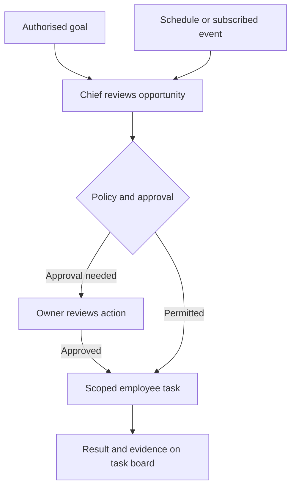

# BotOrgHQ

**Run AI teams with clear reporting lines, owned tasks, and evidence you can review.**

BotOrgHQ gives DeepSeek Harness (DSH) a company workbench. Create companies and departments, assign work through a Chief Bot, and see what each Bot is doing. Follow a task from its acceptance criteria through to its result and evidence.

[**Download v0.4.0**](#download) · [Quick start](#quick-start) · [How autonomy works](#proactive-autonomy) · [简体中文](README.zh-CN.md)


## Download

BotOrgHQ **v0.4.0** is available as a desktop app with DSH bundled, or as a plugin for an existing **DSH 0.2.2-rc.2** installation. It integrates **DS Bot 0.3.1**.

| Platform | v0.4.0 package |
| --- | --- |
| macOS · Apple Silicon | [Download ZIP](https://github.com/xtshanlei/BotOrgHQ/releases/download/v0.4.0-desktop/BotOrgHQ-0.4.0-mac-arm64.zip) |
| macOS · Intel | [Download ZIP](https://github.com/xtshanlei/BotOrgHQ/releases/download/v0.4.0-desktop/BotOrgHQ-0.4.0-mac-x64.zip) |
| Windows · x64 | [Download installer](https://github.com/xtshanlei/BotOrgHQ/releases/download/v0.4.0-desktop/BotOrgHQ-0.4.0-win-x64.exe) |
| Existing DSH installation | [Download plugin](https://github.com/xtshanlei/BotOrgHQ/releases/download/v0.4.0-desktop/bot-org-hq-0.4.0.tgz) |

[Release notes](https://github.com/xtshanlei/BotOrgHQ/releases/tag/v0.4.0-desktop) · [SHA-256 checksums](https://github.com/xtshanlei/BotOrgHQ/releases/download/v0.4.0-desktop/SHA256SUMS.txt) · [All releases](https://github.com/xtshanlei/BotOrgHQ/releases)

This is a pre-release. The macOS app is ad-hoc signed and has yet to be notarised by Apple. The Windows installer is unsigned.

## What you can do

| Feature | How it helps |
| --- | --- |
| **Companies and departments** | Open a department to see its reporting tree and live Bot activity. Click an employee to open its native conversation. |
| **Delegation and delivery** | Assign work with an owner, expected outcome, and acceptance criteria. Track it through To-do, In progress, Waiting, Finished, or Aborted. |
| **Reviewable results** | Attach links, file paths, conversations, or verification records as evidence. Review the result and change history on the task card. |
| **Proactive goals** | Let the Chief review an authorised goal on a schedule or in response to a subscribed event while the host is running. |
| **Portable workspace** | Update in place with a data backup, or export and import an encrypted DSH profile from the desktop app. |

## Quick start

1. **Install.** On macOS, unzip the download and move BotOrgHQ.app to Applications. On Windows, run the installer.
2. **Create a company.** Open **BotOrgHQ** in the sidebar, choose **New company (＋ 新建公司)**, and add a department. Configure a DSH model for the Chief and any Bots you want to use.
3. **Delegate a first task.** Open **Group Chief (打开集团 Chief)** and give it a goal with a clear deliverable. Open **Task board (任务看板)** to inspect the task, its owner, and the evidence.

Try this in the Chief conversation:

> Create a research studio with Research and Editorial departments. Add a research lead and an analyst, with the analyst reporting to the lead. Assign the analyst an evidence-summary task. Ask for three traceable sources, a written summary, and a verification note on the task card.

<details>
<summary>Install the plugin into an existing DSH profile</summary>

In **DSH Desktop 0.2.2-rc.2**, open **Plugins → Add plugin**, enter the absolute path to the downloaded package, and enable it. Open BotOrgHQ from the sidebar. If that profile uses the original DS Bot plugin, disable the original entry before enabling BotOrgHQ.

For DSH Web, use the DSH CLI and pnpm:

```sh
dsh plugin --profile web add /absolute/path/bot-org-hq-0.4.0.tgz
dsh web
```

</details>

## Proactive autonomy

Autonomy starts **off**. In the company workbench, set a goal and start in **Suggest** mode to review the Chief’s plans. When you are ready to allow execution, configure **Supervised** or **Bounded Auto** with the appropriate permissions, evidence scope, budgets, and approval rules.



Bounded execution covers company-scoped analysis and drafting through configured DSH models. The local DSH host must be running for schedules and triggers to execute. The workbench shows plan and execution history, evidence, and approval decisions. Owners can pause a company, department, or Bot.

[Set up goals, triggers, and approvals (中文)](docs/proactive-user-guide.md) · [Execution boundaries and architecture](docs/proactive-architecture.md)

## Updates and data

- **Upgrading from 0.2.0?** Download and install v0.4.0 manually. From 0.3.0 onward, use **Help → Check for updates…**, also available in the **BotOrgHQ** menu on macOS.
- **Upgrading in place** verifies the package and backs up the DSH profile before installation. Running tasks are interrupted during the update.
- **Moving to another machine?** Use **Help → Export or import data…** to transfer the local DSH profile as a password-encrypted archive. Imported proactive work starts paused. Handle backups as sensitive data because they contain credentials.

[Migration, backup, and recovery guide (中文)](docs/proactive-migration.md) · [Changelog](CHANGELOG.md)

## Develop and contribute

Use **Node.js 24.9+**. Build desktop installers on the target operating system and architecture.

```sh
npm ci
npm test
npm run build
npm --prefix desktop ci
npm --prefix desktop run dist
```

For local desktop development, run `npm --prefix desktop run prepare-runtime` followed by `npm --prefix desktop start`. Open an issue for bugs or ideas and include your BotOrgHQ version, platform, and steps to reproduce. Leave credentials and profile archives out of reports.

[Upstream integration and attribution](docs/upstream.md) · [DS Bot Apache-2.0 licence](third-party/DS-Bot-LICENSE) · [DS Bot notice](third-party/DS-Bot-NOTICE)
