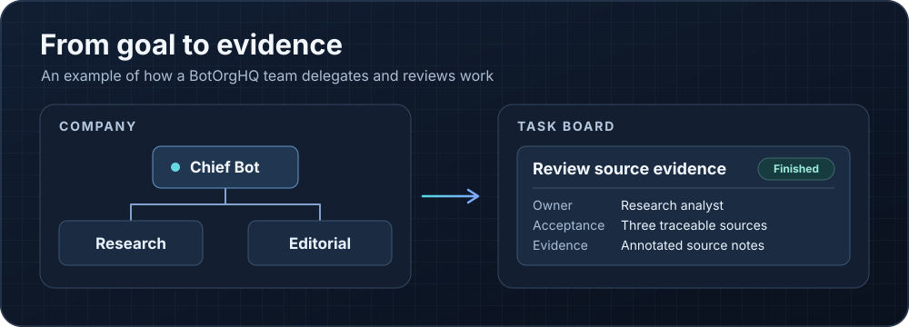
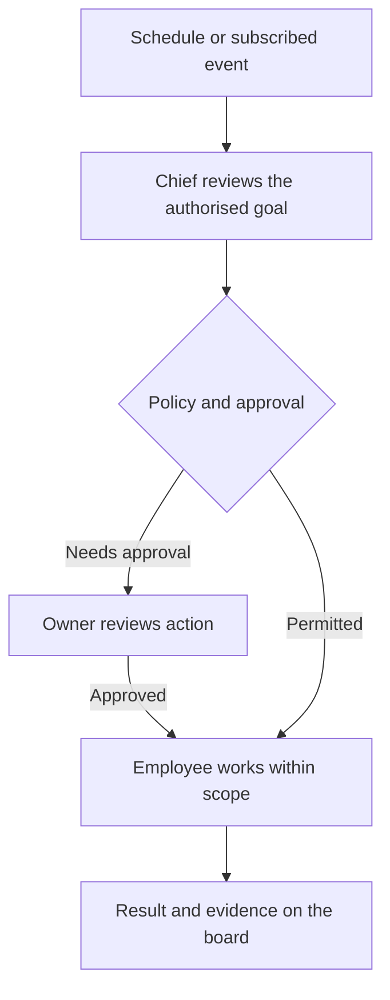

# BotOrgHQ

**Give your AI team a goal it can keep working on.**

Set a long-term goal once. While DeepSeek Harness (DSH) is running, the Chief Bot can review it on a schedule or after a subscribed event, delegate work to the right department, and return results with evidence. You set the permissions, budgets, and approval rules, and can pause the work at any time.

**[Download for macOS or Windows](#download)** · [Start with one goal](#quick-start) · [简体中文](README.zh-CN.md)



## Why BotOrgHQ

| What you need | What BotOrgHQ gives you |
| --- | --- |
| **Progress between conversations** | An authorised goal retains its owner, success criteria, review schedule, and history. The Chief can pick up the next review without a new chat message. |
| **A clear owner for every deliverable** | Companies, departments, and reporting lines give the Chief a structure for delegating work. The company board shows each task’s owner, expected outcome, status, and evidence. Open an employee’s native DSH conversation from the workbench. |
| **Control over what happens next** | Scope data and tools by company, department, or Bot. Set budgets and approval rules, preview decisions in shadow mode, and pause execution when needed. |
| **A record you can check** | Review the goal version, why the Chief acted, what it delegated, and the evidence behind a result. Completion and verification are tracked separately. |

**A weekly research briefing.** The team wants a source-backed briefing every Monday. The owner defines the approved sources and success criteria. The Chief reviews the recurring goal and can delegate source checks and drafting to Research and Editorial Bots. The board shows who did the work, where the claims came from, and what still needs human review. If an action requires approval, it waits for the owner’s decision.

## Download

The desktop app bundles **DeepSeek Harness 0.2.2-rc.2** and integrates **DS Bot 0.3.1**. The same workbench is available as a plugin for an existing DSH installation.

| Platform | Package to select in [GitHub Releases](https://github.com/xtshanlei/BotOrgHQ/releases) |
| --- | --- |
| macOS · Apple Silicon | `BotOrgHQ-…-mac-arm64.zip` |
| macOS · Intel | `BotOrgHQ-…-mac-x64.zip` |
| Windows · x64 | `BotOrgHQ-…-win-x64.exe` |
| Existing DSH installation | `bot-org-hq-….tgz` |

Releases include a SHA-256 checksum file. The macOS pre-release is ad-hoc signed and awaits Apple notarisation. The Windows installer is unsigned.

## Quick start

1. **Launch and choose a language.** Unzip the Mac app and move it to Applications, or run the Windows installer. Open **BotOrgHQ** in the sidebar and choose **English** or **简体中文** under **Language / 语言**. The choice is shared with DSH and saved in your profile. Workbench and desktop interface translations start in **v0.4.1**.
2. **Create the team.** Select **New company**, add a department, and configure a DSH model. Open **Group Chief** to ask it to create Bot employees and set their reporting lines.
3. **Set one recurring goal.** Open **Long-term goals** to add a goal with measurable success criteria and authorise it. Use **Triggers** to choose when it should be reviewed. Open **Autonomy settings** and configure **Suggest** mode first to inspect how the Chief plans.
4. **Review delivery.** When ready, configure **Supervised** or **Bounded auto** with scoped permissions and budgets. Follow decisions in **Proactive activity**, review requests in **Human approvals**, and inspect results and evidence on the **Task board**.

<details>
<summary>Install the plugin into an existing DSH profile</summary>

In **DSH Desktop 0.2.2-rc.2**, open **Plugins → Add plugin**, enter the absolute path to the downloaded package, and enable it. Open BotOrgHQ from the sidebar. If the profile uses the original DS Bot plugin, disable that entry before enabling BotOrgHQ.

For DSH Web, use the DSH CLI and pnpm. Substitute the filename of your downloaded package.

```sh
dsh plugin --profile web add /absolute/path/bot-org-hq-0.4.1.tgz
dsh web
```

</details>

## Proactive autonomy

Autonomy starts **off**. A local DSH host must be running to evaluate goals, run schedules, and process triggers. Authorised runs use the DSH model you configured. The engine limits bounded execution to company-scoped analysis and drafting and applies the configured data scope, permissions, approvals, and budgets.



[Goals, triggers, and approvals (中文)](docs/proactive-user-guide.md) · [Execution boundaries and architecture](docs/proactive-architecture.md)

## Updates and data

- **Update in place.** From v0.3.0 onward, open **Help → Check for updates…**. On macOS, the **BotOrgHQ** menu also contains this command. The app verifies the download and backs up your DSH profile before installing. Running tasks stop during installation. On v0.2.0, download the installer manually.
- **Move your workspace.** Open **Help → Export or import data…** to transfer companies, Bots, settings, conversations, memory, and work history in an encrypted profile archive. Imported proactive work starts paused. Keep profile archives and backups private because they can contain credentials.

[Migration and recovery (中文)](docs/proactive-migration.md) · [Changelog](CHANGELOG.md)

## Develop and contribute

Use **Node.js 24.9+**. Build desktop packages on the target operating system and architecture.

```sh
npm ci
npm test
npm run build
npm --prefix desktop ci
npm --prefix desktop run dist
```

For local desktop development, run `npm --prefix desktop run prepare-runtime` followed by `npm --prefix desktop start`. For issues, include your BotOrgHQ version, platform, and steps to reproduce. Keep credentials and profile archives private.

[Upstream integration and attribution](docs/upstream.md) · [DS Bot Apache-2.0 licence](third-party/DS-Bot-LICENSE) · [DS Bot notice](third-party/DS-Bot-NOTICE)
