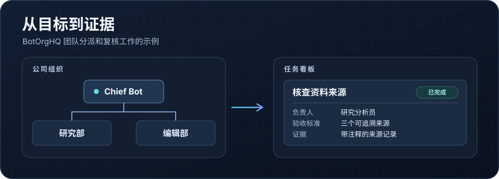
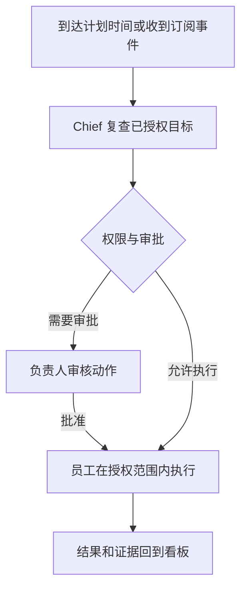

# BotOrgHQ

**给 AI 团队一个目标，让它持续推进。**

设定一次长期目标。只要 DeepSeek Harness（DSH）在运行，Chief Bot 就能按计划或订阅事件复查目标，把工作分派给合适的部门，并交付带证据的结果。权限、预算和审批规则由你设定，工作可以随时暂停。

**[下载 macOS 或 Windows 版](#下载)** · [从一个目标开始](#快速开始) · [English](README.md)



## 为什么用 BotOrgHQ

| 你需要什么 | BotOrgHQ 如何做到 |
| --- | --- |
| **两次对话之间也有进展** | 授权目标保留负责人、成功标准、复查计划和历史。到了复查时间，Chief 可以继续推进，无需你再发一条消息。 |
| **每个交付件都有负责人** | 公司、部门和汇报线为 Chief 提供分工依据。公司看板展示谁负责、预期交付什么、做到哪一步、证据在哪里。点击员工可打开其原生 DSH 对话。 |
| **你决定哪些工作可以执行** | 以公司、部门或 Bot 为粒度设定数据与工具范围、预算和审批规则。可以用影子模式预览决策，也可以随时暂停。 |
| **交付有迹可查** | 可以核对当时的目标版本、Chief 的行动理由、分派记录和交付证据。完成和验证分别记录。 |

**以每周研究简报为例。** 一个团队希望每周一收到一份有来源的简报。负责人指定允许使用的资料和成功标准。Chief 定期复查目标，可将来源核验和起草分派给研究部与编辑部。打开看板就能看到谁做了什么、结论来自哪里、还有什么需要人工复核。需要审批的动作会等待负责人决定。

## 下载

桌面应用内置 **DeepSeek Harness 0.2.2-rc.2**，并集成 **DS Bot 0.3.1**。已有 DSH 的用户可以安装插件，使用同一套工作台。

| 平台 | 在 [GitHub Releases](https://github.com/xtshanlei/BotOrgHQ/releases) 中选择 |
| --- | --- |
| macOS · Apple 芯片 | `BotOrgHQ-…-mac-arm64.zip` |
| macOS · Intel 芯片 | `BotOrgHQ-…-mac-x64.zip` |
| Windows · x64 | `BotOrgHQ-…-win-x64.exe` |
| 已安装 DSH | `bot-org-hq-….tgz` |

发布页提供 SHA-256 校验文件。macOS 预发行版采用 ad-hoc 签名，尚待 Apple 公证。Windows 安装器未签名。

## 快速开始

1. **启动并选择语言。** Mac 上解压后将应用移到「应用程序」，Windows 上运行安装器。在侧栏打开 **BotOrgHQ**，用 **Language / 语言** 选择 **English** 或 **简体中文**。设置与 DSH 共用，保存在用户配置中。工作台和桌面界面从 **v0.4.1** 开始支持切换。
2. **建立团队。** 点击 **新建公司**，添加部门并配置 DSH 模型。打开 **集团 Chief**，让它创建 Bot 员工并设置汇报关系。
3. **设立一个周期目标。** 在 **长期目标** 中录入可衡量的成功标准并授权，在 **触发器** 中设定复查时间。先在 **自治设置** 启用 **仅建议** 模式，检查 Chief 的规划。
4. **跟进交付。** 准备就绪后，可配置 **监督执行** 或 **有界自治**，设定权限和预算。在 **主动活动** 查看决策、在 **人工审批** 处理请求，并到 **任务看板** 核对结果与证据。

<details>
<summary>在现有 DSH 配置中安装插件</summary>

在 **DSH Desktop 0.2.2-rc.2** 中打开 **插件 → 添加插件**，输入下载包的绝对路径并启用，然后从侧栏打开 BotOrgHQ。如果该配置已启用原版 DS Bot 插件，先停用原版入口。

DSH Web 用户可通过 DSH CLI 和 pnpm 安装。将文件名替换成你下载的版本。

```sh
dsh plugin --profile web add /absolute/path/bot-org-hq-0.4.1.tgz
dsh web
```

</details>

## 主动自治

自治默认关闭。本机 DSH 宿主运行时，系统可以复查目标、执行计划、处理触发事件。获得授权后，引擎使用你配置的 DSH 模型，在公司范围内进行有界分析和起草，并执行数据范围、工具权限、审批与预算规则。



[目标、触发器与审批指南](docs/proactive-user-guide.md) · [执行边界与架构（English）](docs/proactive-architecture.md)

## 更新与数据

- **原地升级。** v0.3.0 起可打开 **帮助 → 检查更新…**。macOS 的 **BotOrgHQ** 菜单也提供此命令。应用校验下载并在安装前备份 DSH 配置。安装期间运行中的任务会停止。v0.2.0 用户需手动下载安装包。
- **迁移工作区。** 用 **帮助 → 导出或导入数据…** 创建加密归档，将公司、Bot、设置、对话、记忆和工作记录迁移到另一台机器。导入后，主动工作保持暂停。备份和归档可能包含凭证，请妥善保管。

[迁移与恢复指南](docs/proactive-migration.md) · [版本记录（English）](CHANGELOG.md)

## 开发与贡献

使用 **Node.js 24.9+**，在目标操作系统和架构上打包桌面应用。

```sh
npm ci
npm test
npm run build
npm --prefix desktop ci
npm --prefix desktop run dist
```

本机开发可先执行 `npm --prefix desktop run prepare-runtime`，再执行 `npm --prefix desktop start`。提交问题时，请附上版本、平台及复现步骤，并妥善保管凭证和用户归档。

[上游集成与鸣谢（English）](docs/upstream.md) · [DS Bot Apache-2.0 许可证](third-party/DS-Bot-LICENSE) · [DS Bot 声明](third-party/DS-Bot-NOTICE)
