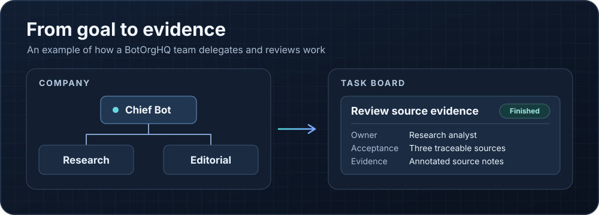

# BotOrgHQ

**让 AI 团队按公司协作，任务有负责人，结果有证据可查。**

BotOrgHQ 是 DeepSeek Harness（DSH）的公司工作台。你可以建立公司和部门，由集团 Chief 分派任务，在组织图里查看 Bot 的汇报关系和工作状态，并从看板追踪每项任务的验收标准、结果和证据。

[**下载 v0.4.0**](#下载) · [快速上手](#快速上手) · [主动自治](#主动自治) · [English](README.md)



## 下载

**v0.4.0** 提供内置 DSH 的桌面版，以及可装到现有 **DSH 0.2.2-rc.2** 的插件。BotOrgHQ 集成 **DS Bot 0.3.1** 的原生会话、交接、群聊和记忆能力。

| 系统 | v0.4.0 下载 |
| --- | --- |
| macOS · Apple 芯片 | [下载 ZIP](https://github.com/xtshanlei/BotOrgHQ/releases/download/v0.4.0-desktop/BotOrgHQ-0.4.0-mac-arm64.zip) |
| macOS · Intel 芯片 | [下载 ZIP](https://github.com/xtshanlei/BotOrgHQ/releases/download/v0.4.0-desktop/BotOrgHQ-0.4.0-mac-x64.zip) |
| Windows · x64 | [下载安装程序](https://github.com/xtshanlei/BotOrgHQ/releases/download/v0.4.0-desktop/BotOrgHQ-0.4.0-win-x64.exe) |
| 已有 DSH | [下载插件](https://github.com/xtshanlei/BotOrgHQ/releases/download/v0.4.0-desktop/bot-org-hq-0.4.0.tgz) |

[发布说明](https://github.com/xtshanlei/BotOrgHQ/releases/tag/v0.4.0-desktop) · [SHA-256 校验文件](https://github.com/xtshanlei/BotOrgHQ/releases/download/v0.4.0-desktop/SHA256SUMS.txt) · [所有版本](https://github.com/xtshanlei/BotOrgHQ/releases)

当前版本为预发行版。Mac 应用使用 ad-hoc 签名，尚未经过 Apple 公证。Windows 安装器尚未签名。

## 快速上手

1. **安装桌面版。** Mac 解压后将 BotOrgHQ.app 放入“应用程序”，Windows 运行 EXE 安装器。
2. **建立公司。** 从左侧进入 **BotOrgHQ** 公司工作台，点击 **＋ 新建公司**，填写名称和职责，再用 **＋ 新建部门** 添加部门。
3. **分派任务。** 配置 DSH 模型后，点击 **打开集团 Chief** 交代工作，在 **任务看板** 查看负责人、交付结果和验收标准。

你可以给 Chief 这条指令：

> 建立研究工作室，设立研究部和编辑部。聘用研究主管和分析师，让分析师向研究主管汇报。请主管在公司任务看板上分派一项证据整理工作，要求提交可追溯的来源、总结和验证记录。

<details>
<summary>安装到现有 DSH</summary>

在 **DSH Desktop 0.2.2-rc.2** 中打开 **Plugins → Add plugin**，输入下载的 `bot-org-hq-0.4.0.tgz` 的绝对路径，启用后从侧栏进入 BotOrgHQ。同一个 profile 若已启用原始 DS Bot 插件，先停用原入口。

DSH Web 使用 DSH CLI 和 pnpm：

```sh
dsh plugin --profile web add /absolute/path/bot-org-hq-0.4.0.tgz
dsh web
```

各插件使用各自的数据目录。旧 BotOrgHQ v0.1 SQLite 和独立 DS Bot 名册仍需要单独导入。公司权限覆盖本插件的组织工具和任务看板。DS Bot 的团队共享记忆与团队设置沿用上游行为。

</details>

## 组织图与任务看板

**查看团队。** 点击部门查看员工和直属汇报树，点击员工打开原生对话。工作状态指示灯反映 Bot 当前是否有任务在运行。

**调整汇报关系。** 在工作台点击 **修改部门 / 直属关系**，选择员工、部门和直属上级。上级可以来自同一公司的其他部门。系统校验自我汇报、汇报循环和跨公司上级。调整组织保留 Bot 身份、会话和记忆。

**追踪交付。** 人和 Bot 使用同一块持久化看板。任务卡记录负责人、预期结果、验收标准、实际结果、证据与变更历史。可引用链接、文件、对话或验证记录。系统检查必填信息，证据的真实性由审阅者确认。

| 状态 | 含义 |
| --- | --- |
| To-do | 已记录，等待开始 |
| In progress | 负责人已开始 |
| Waiting | 等待审批、输入或其他依赖 |
| Finished | 已填写实际结果和证据 |
| Aborted | 已记录终止原因 |

<details>
<summary>Bot 工具、任务权限与并发编辑</summary>

| 工具 | 用途 |
| --- | --- |
| `org_list` | 查看公司、部门、员工和汇报关系 |
| `org_hire` | 创建原生 Bot 并记录所属部门和直属上级 |
| `org_create_department` | 在授权的公司添加部门 |
| `org_change_reporting` | 调整部门和直属关系 |
| `org_task_list` | 查看公司任务、证据与编辑历史 |
| `org_task_create` / `org_task_update` | 创建任务卡并更新负责人、状态、结果及证据 |
| `org_delegate` | 建立任务卡并通过 DS Bot 原生交接发送给员工 |

公司员工可阅读本公司看板、修改自己或直属下属的任务。Chief 和人类操作者可管理公司看板。Chief 或当前直属上级可使用 `org_change_reporting` 调整关系。旧版本的并发编辑会触发 revision 检查，提示重新读取。

</details>

## 主动自治

自治默认关闭。在 **长期目标** 中定义目标和验收标准，配置访问范围、预算与审批方式。可先用 **Suggest** 模式查看计划，再选择 **Supervised** 或 **Bounded Auto** 开放授权动作。

本机 DSH 宿主运行期间，Chief 可以按计划或订阅事件复查目标。主动模式使用已配置的模型，在公司范围内执行资料分析与草稿任务。**主动活动** 可查看执行过程和证据，**人工审批** 可核准待执行动作，**自治设置** 可暂停公司、部门或 Bot。

[设置目标、触发器和审批](docs/proactive-user-guide.md) · [执行边界与架构](docs/proactive-architecture.md)

## 更新、备份和迁移

- **从 0.2.0 升级**时，请手动下载并安装 v0.4.0。从 0.3.0 起可使用 **帮助 → 检查更新…**，Mac 也可从 **BotOrgHQ** 菜单打开。
- **应用内更新**会校验 SHA-256，停止 DSH 并备份资料后再安装。升级期间正在运行的任务会中断。新版本首次启动会在内核迁移前建立快照。组织数据 v1 迁移到 v2 时保留原始备份。
- **迁移到另一台机器**时，从 **帮助 → 导出或导入数据…** 生成密码加密的 DSH 归档。导入的主动任务从暂停状态开始。备份内包括配置、凭据、组织、任务、对话、附件和记忆，请按原数据同样保护。

| 系统 | 默认数据目录 |
| --- | --- |
| macOS | `~/Library/Application Support/BotOrgHQ` |
| Windows | `%APPDATA%/BotOrgHQ` |
| Linux | `~/.config/BotOrgHQ` |

在 **帮助 → 打开数据目录** 查看实际位置。更新窗口中的 **打开备份文件夹** 可找到快照。Mac 更新会保留旧应用包副本。若之前为私有仓库更新保存了 GitHub Token，可在更新窗口的 **私有 GitHub 仓库访问** 中清除。

[升级、加密迁移及回滚](docs/proactive-migration.md) · [变更记录](CHANGELOG.md)

## 开发和发布

使用 **Node.js 24.9+**，在目标操作系统和架构上打包。

```sh
npm ci
npm test
npm run build
npm --prefix desktop ci
npm --prefix desktop run dist
```

本地启动桌面版前，先运行 `npm --prefix desktop run prepare-runtime`，再运行 `npm --prefix desktop start`。打包后的内核和重启保留可通过 `node scripts/smoke-desktop.mjs` 检查。

GitHub Actions 为 Windows x64、Mac arm64 和 Mac x64 构建并验证安装包。发布任务把安装包与插件上传至草稿，校验附件后再发布。升级版本时同步根目录与 `desktop` 下的版本号和 lockfile。提交问题时请附上版本、平台和复现步骤，避免附带凭证或完整资料归档。

[上游集成与归属](docs/upstream.md) · [DS Bot Apache-2.0 许可证](third-party/DS-Bot-LICENSE) · [DS Bot NOTICE](third-party/DS-Bot-NOTICE)
