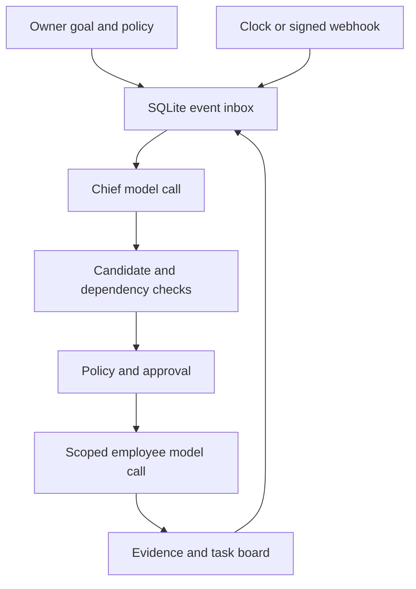
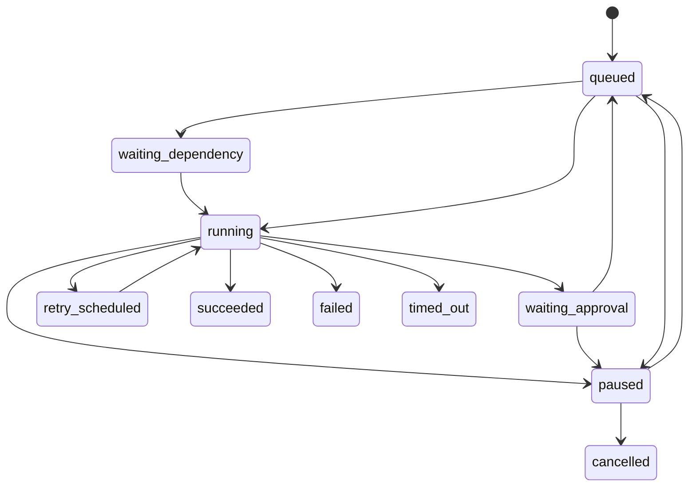

# Proactive autonomy architecture

## M0 baseline

BotOrgHQ v0.3.0 uses DSH 0.2.2-rc.2 and DS Bot 0.3.1. The original organisation JSON,
native Bot sessions, memory, task board and desktop updater remain the owners of their
existing data. The baseline passed ten tests and built the DSH client bundle. The
standalone app runs the plugin in a child Node process using its existing DSH home.

The engine uses Node 24's built-in SQLite in that DSH home. The plugin already requires
Node >=24.9 and desktop packaging copies the actual platform's Node executable.
SQLite is additive, uses WAL and full synchronisation, and falls under the existing
desktop backup. No original data is migrated into it.

DSH authenticates Fetch routes before handing them to plugins. An administrative
operation also requires the owner capability and same-origin browser request checks.
Bot identity comes from the DS Bot session, never a model argument. Webhooks use
separate HMAC verification and project bindings. External payloads are treated as
data with bounded projections.

## Delivery sequence

1. M1 and M2 add transactional storage, inherited policy, ceilings, goal versions,
   persistent triggers and authenticated ingress.
2. M3 adds bounded configured-model calls, Chief planning, scoped delegations,
   dependency execution, evidence and recovery.
3. M4 adds expiring approvals and invalidation checks at execution boundaries.
4. M5 and M6 expose the engine in the existing workbench and harden the native
   lifecycle, backups, export and cross-platform verification.

The pinned DS Bot handoff starts a normal recipient chat turn. That turn may access
the Bot's skills, external adapters, scheduler and tools, including paths outside
the DSH native tool guard. A tool guard alone therefore cannot safely wrap it as
unrestricted autonomous work. The bounded executor uses real roster identities and
configured session models, with an explicit host-owned capability list, no model tool
registrations, and persistent task board handoffs. Manual chat and native message_bot
retain their existing behaviour.

## Execution and state

The host chooses a roster identity and a configured DSH route, then sends a bounded
one-shot request with an empty tool schema. It never sends the Bot's private chat,
secret store, team memory or DSH system prompt to the autonomous planner. Company
task summaries, specifically subscribed webhook data, and owner-confirmed notes are
the evidence supplied to the model. The engine records the model route and usage
separately from the untrusted candidate output.

Work is enqueued in the same SQLite transaction as a delegation decision. The legacy
board projects proactive runs from SQLite rather than copying them into the existing
JSON store. Plans and results commit together with the evidence and audit records.
Claims carry a per-profile lease. A restart resumes safe checkpoints, uses delayed
retries for failed calls, and pauses an indeterminate in-flight call for review.
Before each action, the engine rechecks the active goal version and parent versions,
employment and company scope, policy version, lease, budgets and approval binding.

## Enforcement coverage

| Capability | Enforcement |
| --- | --- |
| Chief or employee DSH model calls | Empty tool schema, explicit Bot identity, scope, wall time, reservation and provider usage accounting |
| Company evidence reads | Structured excerpts and stable references from that company's records |
| Proactive delegation and result submission | Host-mediated R1 actions, recorded argument hashes, exact policy/goal revision checks, transactional workflow state |
| Owner settings, approvals and verification | DSH owner-only Fetch transport, browser origin checks, no approving Bot tool |
| External events | HMAC, subscription and repository checks, replay hashes; event text is untrusted |
| Full native chat turns, PTC, shell, browser/computer, connectors, external writes, provider-hosted workflows | Outside autonomous coverage. A DSH tool guard cannot establish a transitive worker identity or bound every provider-side turn. The proactive engine never starts these paths. Manual native DSH and DS Bot interactions retain upstream semantics. |

Provider billing requires authoritative model-specific prices and counters. Daily
token accounting reserves conservative UTF-8 bytes plus output allowance and retains
provider totals when reported. With a monetary cap set and pricing unavailable,
model calls are blocked. Any charge that occurred before a process was killed cannot
be inferred from the database. Such calls are not automatically replayed.

The OS process, the configured DSH owner session, installed plugins and the selected
model provider are trusted. This gateway does not protect against a compromised
owner cookie, a malicious plugin or a compromised machine. The webhook listener is
local-only and needs an owner-operated TLS proxy for external ingress.

Verification distinguishes an intact source reference from validation of a claim.
Dependent internal work can use an intact but provisional prior result as input.
An affirmative human review or an explicitly selected deterministic source-quote check advances the verified tally. The quote check confirms exact references and quotations, not the truth of general claims. The audit export
excludes model prompts, webhook bodies and secrets. The full encrypted profile
export intentionally preserves local data, including DSH secrets stored inside it.

## Implementation coverage and follow-up

| Milestone | Coverage |
| --- | --- |
| M0 | Existing source, DSH connection principal and upstream handoff analysis |
| M1 | SQLite v1, inherited OFF policy, model and tool budgets, active-scope and emergency stop |
| M2 | Versioned goal DAG, one-time/interval/cron/heartbeat, internal task observation, GitHub and generic signed ingress |
| M3 | Configured DSH Chief and employee routes, plan DAG, company board cards, scoped results, reference checks, checkpoint and recovery |
| M4 | Exact-action approvals, revocation, expiry, changed-goal and policy invalidation, approval cooldown by exact operation |
| M5 | Existing workbench tabs, employee status, review/export and local notification preferences |
| M6 | Additive storage, import quarantine, portable encrypted export/import, native smoke and PR platform build matrix |

Native cross-Bot chat turns and external write tools require additional upstream integration. Missed event recovery combines schedule catch-up, signed webhook redelivery and optional read-only GitHub feed polling with a retained cursor. Polling is bounded by the recent feed window and does not reconstruct events GitHub no longer returns. Verification does not execute
arbitrary repository tests or validate third-party signatures. The workbench measures
observed events and known outcomes. It does not claim to measure unseen opportunities.
See the PR checks for native platform results.
